<p align="center">
  <a href="https://github.com/Alaa-Alyy">
    
  </a>
</p>

<p align="center">
  
  
  
</p>

---

### 🐍 about me

```python
class AlaaAly:
    role      = "ai engineer"
    house     = "slytherin 🐍"
    focus     = ["computer vision", "deep learning", "nlp", "on-device ai"]
    currently = "building a two-way egyptian sign language translator 🤟"
    learning  = ["sequence models", "model compression", "arabic nlp"]
    goal      = "ai that helps people communicate"
```

---

### 🔥 what i'm working on

- 🤟 a mobile app where a deaf person **signs** and the phone **speaks**, and a hearing person **talks** and a 3d avatar **signs back**
- 👁️ hand, body, and face tracking with mediapipe
- 📱 running ai models directly on the phone, offline
- 🗣️ egyptian arabic speech and language understanding

---

### 🛠️ tech stack

<p align="center">
  
  <br/>
  
</p>

---

### 🚀 featured project

> **two-way egyptian sign language translator** 🤟 *(graduation project, in progress)*
>
> 🖐️ **sign → speech:** the app recognizes the signed sentence and speaks it in egyptian arabic
> 🗣️ **speech → sign:** the app understands what was said and a 3d avatar signs it back
> ⚡ runs on the phone, works offline, keeps video private
> 📖 a sign dictionary the community helps build

---

### 🎲 fun facts

- the robot in my profile picture is made of old tvs and scrap metal 🤖♻️
- i debug with print statements and i'm not sorry
- dark mode only. always. 🌑

---

### 📊 github stats

<p align="center">
  
  
</p>

<p align="center">
  
</p>

---

### 🐍 contribution snake



<p align="center"><sub>thanks for visiting 🖤 · mischief managed ✨</sub></p>


